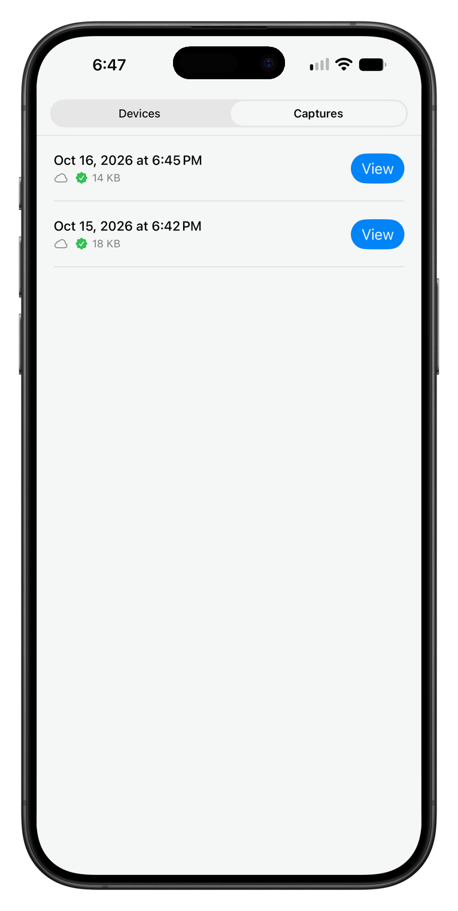
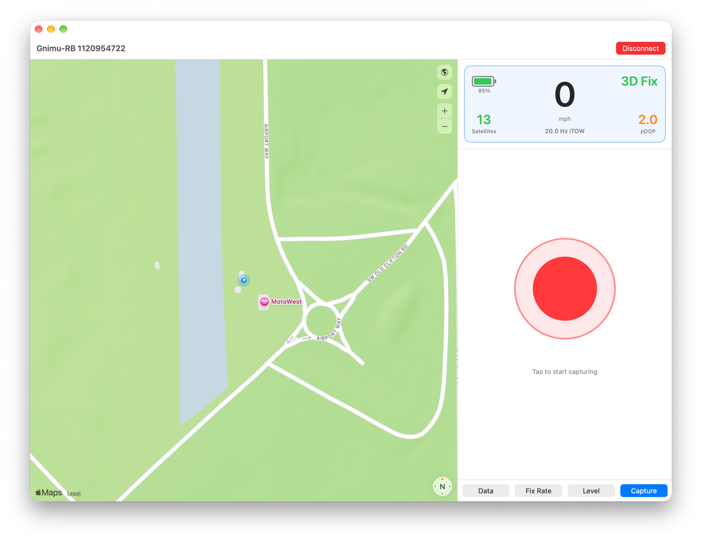
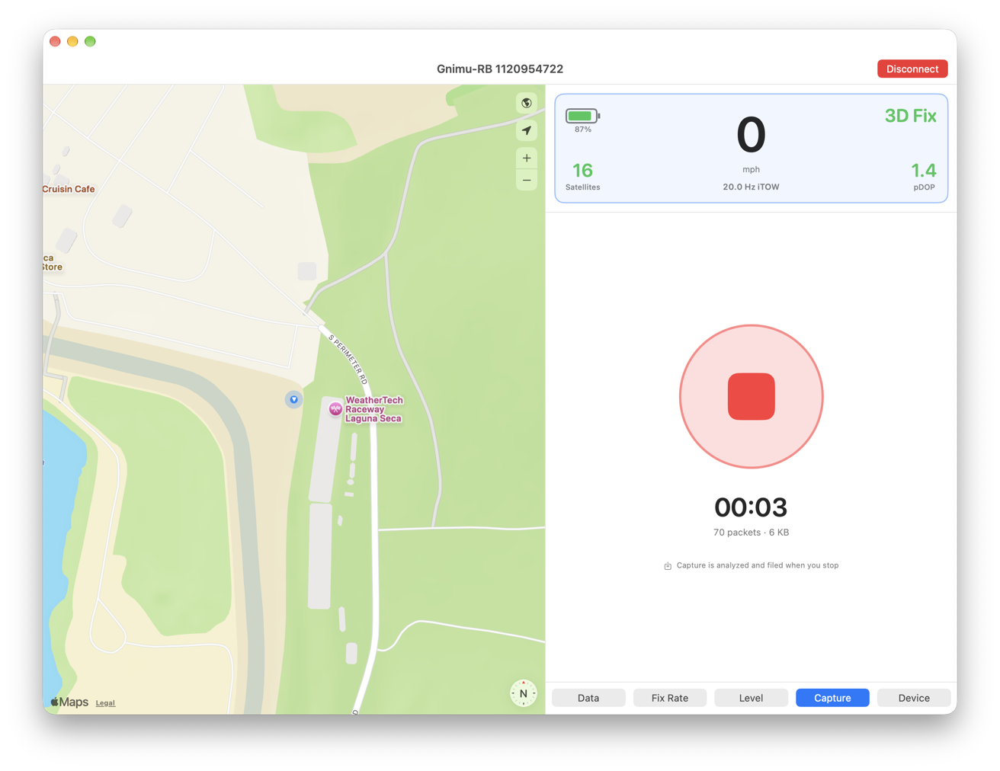
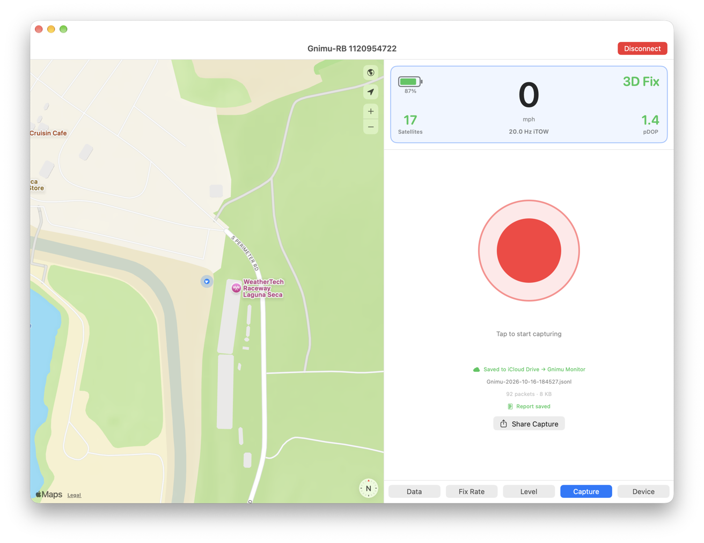

  
  <picture>
    <source media="(prefers-color-scheme: dark)" srcset="https://raw.githubusercontent.com/c20d-us/Gnimu-branding/main/wordmark/gnimu-wordmark-transparent-white.svg">
    
  </picture>

# Gnimu Monitor

A macOS/iOS app for monitoring real-time output from a [Gnimu](https://github.com/c20d-us/Gnimu) (nigh-mew) open-source GNSS+IMU telemetry device. Gnimu streams telemetry over BLE (Bluetooth Low Energy) using the publicly documented RaceBox data protocol, and I built this app to validate Gnimu functionality. It reads that protocol, so other devices that stream it may work too, but I've only tested it with Gnimu.

> [!IMPORTANT]
> **Unofficial project.** This is an independent, educational, and non-commercial implementation. It is **not affiliated with, endorsed by, or supported by RaceBox.** "RaceBox" and related marks belong to their respective owner, and are used here only to describe the protocol this app is compatible with. Use this code for learning and personal purposes only, and at your own risk. Do not use this code for any commercial or fraudulent purpose.

## What it does

Gnimu Monitor opens on a device picker. It lists nearby devices that stream the RaceBox data protocol, each labelled with its protocol and a signal-strength indicator. Pick one and connect. A **Devices / Captures** switch at the top of the picker also gives access to the saved captures and their analysis reports (see [Capture and analysis](#capture-and-analysis)).

Once connected, the screen is laid out for the size of the display.

- **Mac and iPad (wide layouts):** a live map on the left. On the right, a glance box above a switchable panel, with buttons below to choose between **Data**, **Fix Rate**, **Level** and **Capture**.
- **iPhone (and iPad in Split View):** the glance box stays at the top, above a row of swipeable pages: **Map**, **Data**, **Fix Rate**, **G-Force**, **Level** and **Capture**. The G-Force meter exists only in this layout.

Disconnecting returns to the picker. On iPhone and iPad the screen stays awake while connected, and the connection is dropped when the app goes to the background.

### Glance box

Ground speed in the middle, with battery level (and charging state), satellite count, GNSS fix status and [pDOP](https://en.wikipedia.org/wiki/Dilution_of_precision) around it, and the live fix rate along the bottom edge. Tap or click the speed to switch between MPH and KPH.

### Panels

- **Map:** the device's position and heading on a standard or satellite map. Follow mode keeps it centred, and you can zoom in and out or pan away from the device.
- **Data:** every field the device reports, grouped as Position (latitude, longitude, altitude, horizontal and vertical accuracy), Motion (ground speed, speed accuracy, heading, heading accuracy), IMU (lateral, longitudinal and vertical acceleration, roll, pitch and yaw rates) and Time (UTC date and time, GNSS time of week, time accuracy).
- **Fix Rate:** the rate the device is actually producing fixes, worked out from the GNSS time-of-week stamp on each packet so Bluetooth delivery jitter doesn't hide a device problem. It shows the current rate against the device's nominal rate and whether it is holding it, missed and late fixes, running totals for the session, and two one-minute charts: fix rate (with dropouts marked) and satellite count.
- **Level:** a bubble level for mounting the device, driven by the IMU, with pitch and roll readouts. The bubble turns green when the device is within half a degree of level.
- **G-Force (iPhone):** a lateral and longitudinal g meter with the current magnitude.
- **Capture:** record the stream, and see the result. See below.

## Capture and analysis

The **Capture** panel records the packet stream from the connected device. Start and stop with the red button; while recording it shows the elapsed time, the packet count and the file size. The recording keeps each frame exactly as it arrived, with the time it arrived, plus a header describing the session, so a capture can be analyzed later or on another machine.

Captures are saved to iCloud Drive in a *Gnimu Monitor* folder when iCloud is available, and on the device (visible in the Files app on iPhone and iPad) when it isn't. The panel says where a capture went and why, if iCloud was unavailable. **Share Capture** sends the file anywhere else.

When a capture is saved, the app analyzes it automatically and writes an HTML report next to it. The **Captures** list in the picker shows every capture with its size and whether it has a report. From there you can view, share or delete a capture, run or re-run its analysis, or stop one in progress.

A report opens in the app and can be printed or saved as a PDF. It opens with a verdict (clean, mostly healthy, or problems found) and covers:

- **Summary:** packets received against expected, error rate and missed fixes, the longest run with no missed or late fixes, nominal and mean rate, duration and interruptions.
- **Fix cadence:** how steady the device's own fix timing was.
- **Transport vs. device:** every packet carries the device's clock and the time it arrived, so each gap is attributed to the device not producing the fix or to a fix that was produced but delivered late. Arrival spacing and clock drift are charted.
- **GNSS quality:** satellite count, pDOP and accuracy over the capture.
- **Consistency checks:** pass, warn or fail results for the time-of-week sequence, frame integrity, agreement between the clock fields, reported speed against movement between positions, IMU readings at rest, field ranges, battery reporting and whether the capture is complete.
- **Gaps:** each gap, listed.
- **Track:** the shape of the recorded path, coloured by speed.
- **Session:** the device, app and host the capture was recorded on, power and thermal state, and the capture file's details.

## License

This project is licensed under the GNU General Public License, version 3 or (at your option) any later version. See [LICENSE](LICENSE) for details.

The Gnimu name and logo are not covered by this license. See the [Gnimu branding usage policy](https://github.com/c20d-us/Gnimu-branding/blob/main/LICENSE.md).

## Requirements

- Xcode 26.5+
- macOS 26.5+ or iOS 26.5+
- A compatible BLE device (advertises the RaceBox data service)

## Building

Open `GnimuMonitor/GnimuMonitor.xcodeproj` in Xcode and build for your target device. BLE functionality requires a physical device — the simulator does not support Bluetooth.

## iPhone Screenshots

| Device Picker | Live Map | Data Panel | G-Force Meter |
| :---: | :---: | :---: | :---: |
|  |  |  |  |

| Fix Rate Tracker | Level | Capture | Capture List |
| :---: | :---: | :---: | :---: |
|  |  |  |  |

## iPad Screenshots

| Device Picker | Live Map & Data Panel |
| :---: | :---: |
|  |  |

| Fix Rate Tracker | Level |
| :---: | :---: |
|  |  |

| Capture | Capture Complete |
| :---: | :---: |
|  |  |

| Capture List |
| :---: |
|  |

## Mac Screenshots

| Device Picker | Capture List |
| :---: | :---: |
|  |  |

| Live Map & Data Panel | Fix Rate Tracker |
| :---: | :---: |
|  |  |

| Level | Capture |
| :---: | :---: |
|  |  |

| Capture in Progress | Capture Complete |
| :---: | :---: |
|  |  |
